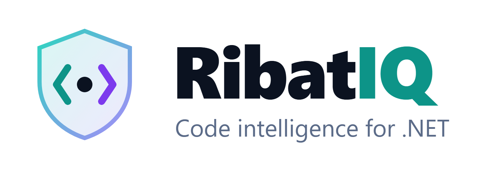

<!-- Relative image paths do not render on nuget.org: switch to absolute URLs once the repository is public. -->
<p align="center">
  <picture>
    <source media="(prefers-color-scheme: dark)" srcset="docs/assets/ribatiq-logo-dark.png">
    
  </picture>
</p>

<p align="center">
  <b>AI-powered code review for C# and .NET, with the LLM of your choice.</b><br>
  <i>Guarding code. Growing intelligence.</i>
</p>

RibatIQ is a code review agent for the command line. It reviews your pull requests or your whole
solution with the AI model you choose (**OpenAI**, **Anthropic** or **Gemini** today; providers are pluggable),
guided by your team's conventions in a `review-rules.md` file. Every AI finding is validated against
the code the model was actually shown, and deterministic Roslyn analysis runs alongside as a safety
net. Findings are reported for people (console) and for tools (JSON, CI exit codes).

- **`ribat review`** reviews the changes between two Git revisions, like a pull request, and reports
  issues on changed lines only.
- **`ribat scan`** audits an existing solution, project or directory, with no pull request needed.

AI analysis is opt-in: without a provider, RibatIQ runs static analysis only and your code never
leaves your machine.

> RibatIQ reports likely issues. It does not prove that code is correct, secure or bug-free, and it
> never modifies your source files.

## Requirements

- .NET SDK 10.0.100 or later.
- Git on the `PATH` for `ribat review`.
- Optionally, an OpenAI, Anthropic or Gemini API key for AI analysis (Gemini has a free tier).

## Installation

RibatIQ is packaged as a .NET tool. Until it is published to NuGet, build and install it from source:

```bash
git clone https://github.com/achrefbrigui/RibatIQ.git
dotnet pack RibatIQ/src/RibatIQ.Cli --configuration Release --output ribatiq-packages
dotnet tool install --global RibatIQ.Cli --add-source ./ribatiq-packages
ribat --version
```

Run these commands from the directory that contains the clone, not from inside it: the repository's
`nuget.config` restricts package sources to nuget.org, which does not allow `--add-source`.

To try it without installing: `dotnet run --project src/RibatIQ.Cli -- <command>`.

## Quick start

```bash
# Static analysis of a solution (.sln/.slnx), a project (.csproj) or a directory
ribat scan path/to/MySolution.sln

# Review what the current branch changed since it diverged from origin/main
ribat review --base origin/main

# Same, with AI analysis and a JSON report, failing on high-severity findings
export ANTHROPIC_API_KEY=...          # PowerShell: $env:ANTHROPIC_API_KEY = "..."
ribat review --base origin/main --provider anthropic --format json --output ribatiq.json --fail-on high

# Security rules only, with a NuGet vulnerability audit (projects must be restored)
ribat scan . --profile security --audit-dependencies

# Choose rules and hide low-severity findings
ribat review --base origin/main --provider openai --enable-rule CLEANCODE.NAMING --min-severity medium
```

Put project conventions for the AI review in a `review-rules.md` file at the repository root; see
[Review rules](docs/review-rules.md).

## Commands and options

```text
ribat scan <path> [options]
ribat review --base <revision> [--head <revision>] [options]
ribat --help | --version
```

| Option | Description |
|--------|-------------|
| `--provider openai\|anthropic\|gemini` | Enable AI analysis with this provider. |
| `--model <id>` | Model to use (defaults: `gpt-6.2-astra`, `claude-opus-5-5`). |
| `--no-ai` | Disable AI analysis; nothing is sent to a provider. |
| `--format console\|json` | Report format (default `console`). |
| `--output <file>` | Write the report to a file instead of standard output. |
| `--fail-on none\|info\|low\|medium\|high\|critical` | Exit with code 1 when a finding is at or above this severity (default `none`). |
| `--include <glob>` / `--exclude <glob>` | Files to analyze / skip (repeatable). `bin/`, `obj/` and `.git/` are always skipped. |
| `--profile default\|security\|performance` | Review profile (default `default`). |
| `--enable-rule <id>` / `--disable-rule <id>` | Turn a catalogue rule on or off (repeatable), e.g. `CLEANCODE.NAMING`. |
| `--min-severity info\|low\|medium\|high\|critical` | Do not report findings below this severity (default `info`). |
| `--instructions <file>` | Project instructions for the AI review (default: `review-rules.md` at the root, if present). |
| `--audit-dependencies` | `scan` only: audit NuGet packages for known vulnerabilities. Projects must be restored. |
| `--config <file>` | Configuration file (default: `ribatiq.json` in the current directory, if present). |
| `--verbose` | Print the effective settings to standard error. |

`review` compares `--head` (default `HEAD`) with its merge base with `--base`, like a pull request, and
reads files at the `--head` revision rather than from the working tree. Run it inside the repository.

## Exit codes

| Code | Meaning |
|------|---------|
| `0` | Completed; no finding met the `--fail-on` threshold. |
| `1` | Completed; at least one finding met the threshold. The report is always written first. |
| `2` | Invalid usage, configuration or input (unknown option, missing file, unknown Git revision, missing API key...). |
| `3` | Operational failure (Git or provider failure, malformed AI response, I/O error). Never reported as a clean result. |

## What is analyzed

**Deterministic analysis** (on by default): sources are parsed in memory by Roslyn; nothing is built,
restored or executed.

| Rule | Finding |
|------|---------|
| `CSxxxx` | C# syntax errors. |
| `RIQ1001` | Empty catch block (catch blocks with a comment are accepted). |
| `RIQ1002` | `async void` method (event handlers excluded). |
| `RIQ1003` | `throw ex;` resets the stack trace. |
| `RIQ1004` | Possible hard-coded secret (the value is never printed). |

Each finding carries a catalogue rule ID such as `SECURITY.EXPOSED_SECRET`, with the tool diagnostic
(`RIQ1004`) next to it.

**Dependency audit** (opt-in, `scan --audit-dependencies`): `dotnet list package --vulnerable` reports
NuGet packages with known advisories. RibatIQ never restores; projects that are not restored are
reported as not audited.

**AI analysis** (opt-in): the model reviews the code against the enabled rules of the catalogue
(correctness, security, performance, .NET practices, clean code, architecture, testing, production
readiness), with the project conventions from `review-rules.md`. Every finding it returns is validated
before it is reported.

Rules, profiles, `review-rules.md` and the meaning of skipped checks are described in
[Review rules](docs/review-rules.md).

| Provider | API key variable | Default model |
|----------|------------------|---------------|
| OpenAI | `OPENAI_API_KEY` | `gpt-6.2-astra` |
| Anthropic | `ANTHROPIC_API_KEY` | `claude-opus-5-5` |
| Gemini | `GEMINI_API_KEY` | `gemini-4-hydrogen` |

Gemini is called through its OpenAI-compatible endpoint. Its free tier is enough to try RibatIQ, but on
that tier Google may use what is sent to improve its products: use it on code you can share, such as
`tests/Fixtures/AiSample`.

See [Security and privacy](docs/security-and-privacy.md) for what is sent to providers and how model
output is validated.

## Configuration

Settings come from, in order of precedence: command-line options, environment variables
(`RIBATIQ_PROVIDER`, `RIBATIQ_MODEL`, `RIBATIQ_FAIL_ON`), the `ribatiq.json` file, then defaults.
API keys are read only from the environment, never from configuration files.

```json
{
  "version": 1,
  "analysis": {
    "exclude": ["**/Migrations/**", "**/*.g.cs"],
    "failOn": "high"
  },
  "ai": {
    "provider": "anthropic"
  },
  "review": {
    "profile": "security",
    "minimumSeverity": "low"
  }
}
```

See [Configuration](docs/configuration.md) and [`samples/ribatiq.json`](samples/ribatiq.json).

## Using RibatIQ in CI

```yaml
- uses: actions/checkout@v7
  with:
    fetch-depth: 0          # review needs the history up to the merge base
- uses: actions/setup-dotnet@v6
  with:
    dotnet-version: 10.0.x
- run: ribat review --base origin/${{ github.base_ref }} --format json --output ribatiq.json --fail-on high
```

The JSON report (`schemaVersion` 2) contains the findings with stable IDs and rule IDs, a summary, the
AI provider and usage, the effective `policy`, the `checks` that ran, were skipped or failed, a
`complete` flag, and a `gate` object with the threshold outcome. Skipped or failed checks do not change
the exit code: test `complete` if your pipeline requires every check.

## Limitations

- C# only. Diagnostics that need project references (types, overloads, nullability) are not reported yet:
  sources are analyzed without building them.
- Source files are found by convention (all `*.cs` under a project directory); explicit `Compile`
  items in project files are not evaluated.
- AI findings are heuristic. Their confidence score is the model's own estimate, not a probability.
- There is no suppression or baseline mechanism yet; finding IDs are stable to make one possible.
- Results are not published to pull requests yet, and there is no SARIF output.
- Most catalogue rules are detected by the AI review only, so they are checked only when a provider is
  configured; the report says when the AI review was skipped.
- Skipped or failed checks do not change the exit code. Test the JSON report's `complete` field if
  your pipeline requires every check.
- The dependency audit only covers NuGet packages of projects that are already restored.
- Out of scope for now: other languages, DAST, automatic fixes, autonomous agents, plugins, custom
  rule languages, and code coverage collection.

## Development

```bash
dotnet build
dotnet test
```

Tests need no API keys and no network access beyond the NuGet restore; provider adapters are tested
against stubbed HTTP. Opt-in tests:

- `RIBATIQ_LIVE_TESTS=1` with an API key calls the real providers (billed).
- `RIBATIQ_NETWORK_TESTS=1` restores a sample project from nuget.org and runs the real dependency audit.

See [Architecture](docs/architecture.md) and [Contributing](CONTRIBUTING.md).

## License

[MIT](LICENSE)
